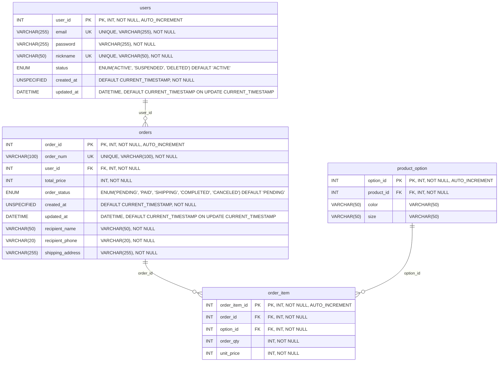

# Fitzza ERD — order_db

자동 생성된 Mermaid ERD입니다. 원본: `fitzza-erd.puml`.

실선은 명시된 FK, 점선은 논리적·조건부 참조입니다. PK/FK/UK는 기본 키/외래 키/단일 컬럼 UNIQUE를 의미합니다. 복합 UNIQUE와 원본 설명은 Mermaid 소스의 주석에 보존합니다. 컬럼 설명에는 원본 타입과 제약조건을 표시합니다. UNSPECIFIED는 원본에 타입이 명시되지 않은 컬럼입니다.

`||`: 정확히 1개, `|o`/`o|`: 0~1개, `o{`: 0개 이상. 점선/실선은 원본 참조 구분을 유지하며 Mermaid의 식별 관계 의미를 별도로 추론하지 않습니다.

